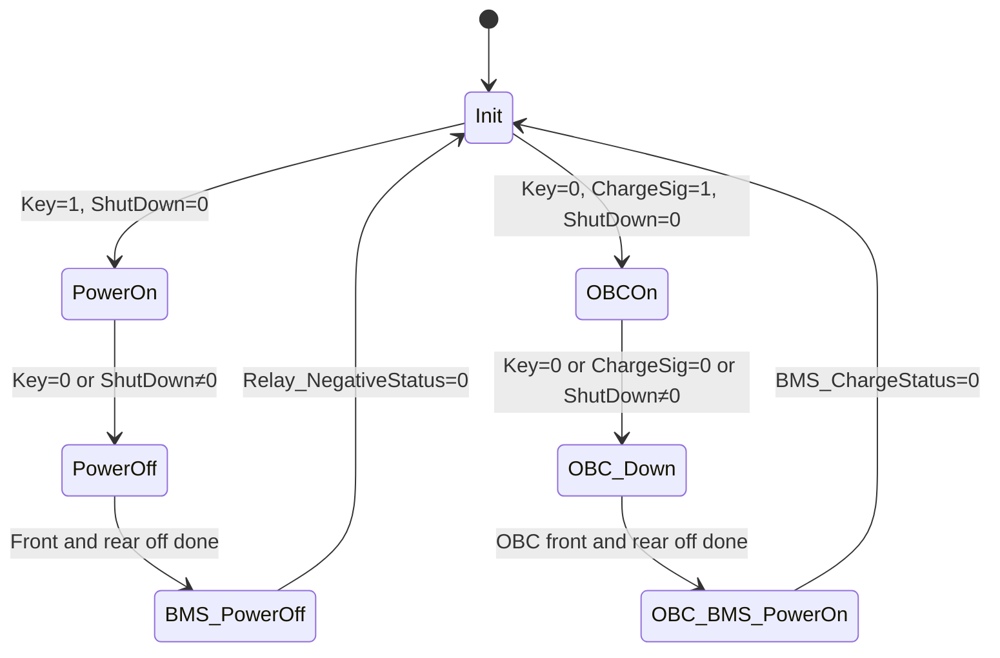
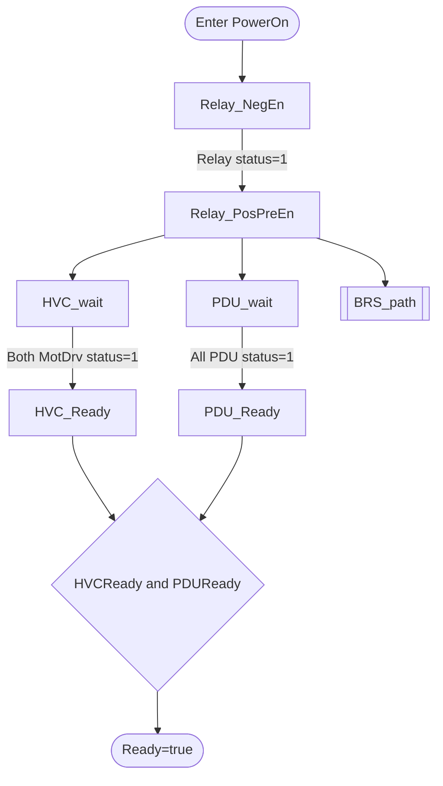
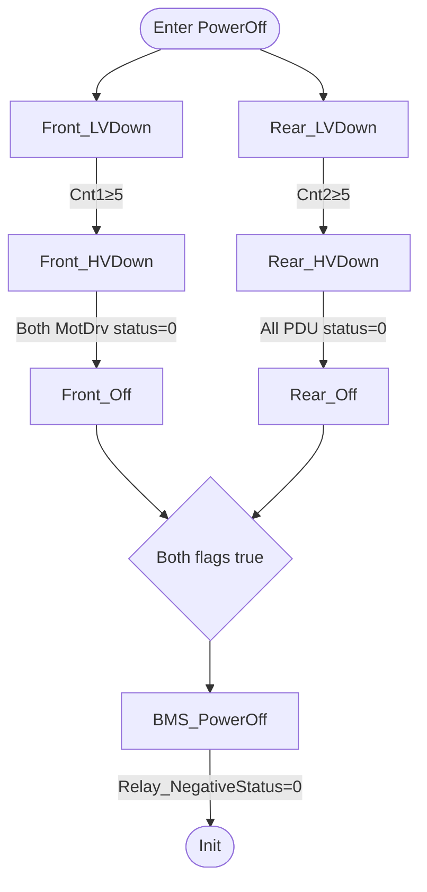
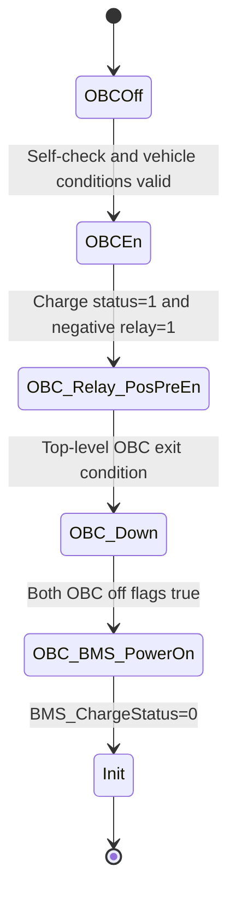
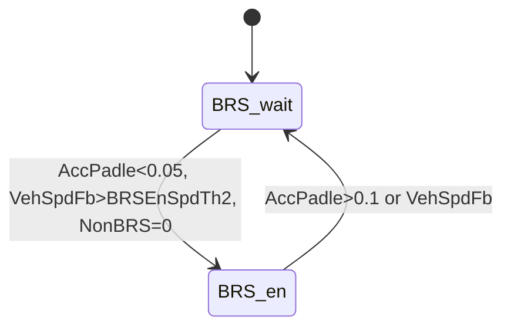

# ZT_VehCtrl_24B 高压、OBC 与 BRS 逻辑分析报告

_对象：`ZT_VehCtrl_24B/VehCtrl/EnergyManage/Chart` · 分析日期：2026-09-28_

---

## 📋 结论摘要

该 `Chart` 是一个顶层互斥、局部并行的能量管理状态机。顶层以 `Init` 为中心，将运行过程分成常规高压上电/下电路径和 OBC 充电上电/下电路径；`BRS_path` 不是独立顶层模式，而是常规 `PowerOn/Relay_PosPreEn` 内的一个并行子状态机。

| 模块 | 已确认的核心功能 | 主要输出 |
| --- | --- | --- |
| 高压上下电 | 负极状态确认后，同时执行 HVC、PDU 和 BRS 三条支路；下电时前后两条支路并行完成，再撤销 `VCU_PowerOnReq` | `VCU_PowerOnReq`、`EDrv1_PowOnCmd`、`EDrv2_PowOnCmd`、`VCU_ShrRlyCtl`、`VCU_HghVtgCtl`、`VCU_DCDC1_En`、`DcdcCmd`、`Ready` |
| OBC 充电 | 校验 `BMS_SelfCheckStatus`、`Gear`、`VehSpdFb` 和 `ParkReleaseSw` 后发出 OBC 与高压相关命令；退出时执行前后并行下电 | `OBCEnSig`、`VCU_PowerOnReq`、`EDrv1_PowOnCmd`、`EDrv2_PowOnCmd`、`VCU_ShrRlyCtl`、`VCU_HghVtgCtl`、`VCU_DCDC1_En`、`DcdcCmd` |
| BRS | 根据 `AccPadle`、`VehSpdFb`、`NonBRS` 和两组速度阈值，在 `BRS_wait` 与 `BRS_en` 间切换 | `OnOffCmd` |

> ⚠️ **结论边界：** 模块结构、状态动作和转移条件是从模型直接导出的已确认事实；功能名称和意图解释属于基于状态结构的合理推测。未执行整车模型仿真，因此不能把静态不一致直接认定为运行故障。

## ⚙️ 分析对象与总体结构

### 数据来源

| 项目 | 内容 |
| --- | --- |
| 模型 | [`ZT_VehCtrl_24B.slx`](../MainModel/ZT_VehCtrl_24B.slx) |
| Chart | `ZT_VehCtrl_24B/VehCtrl/EnergyManage/Chart` |
| 读取方式 | MathWorks MATLAB MCP Server `v0.13.1` 调用 MATLAB R2024b Stateflow API |
| Chart 类型 | `Classic`，动作语言为 `MATLAB`，顶层 `EXCLUSIVE_OR` |
| 导出规模 | 54 个 Data、43 个 State、37 个 Transition、0 个 Junction、0 个 Function |
| 原始证据 | [`ZT_VehCtrl_24B_EnergyManage_Chart_结构导出.json`](./ZT_VehCtrl_24B_EnergyManage_Chart_结构导出.json) |
| 对照资料 | [`高压逻辑梳理0921.pdf`](../../大台架材料/需求与功能文档/高压逻辑梳理0921.pdf)，共 5 页 |

### 顶层状态流

`Init` 的进入动作将多数控制输出置为初始值，包括 `Ready=false`、`VCU_PowerOnReq=0`、`EDrv1_PowOnCmd=0`、`EDrv2_PowOnCmd=0`、`DcdcCmd=0`、`VCU_ShrRlyCtl=0`、`VCU_HghVtgCtl=0`、`OnOffCmd=0`、`OBCEnSig=0` 和 `Flag=1`。`VCU_DCDC1_En` 被置为 `2`，模型中的注释明确写为“停止，不能写0”。

## 📊 与高压逻辑参考图的对比

### 对比口径与结论

参考 PDF 是逻辑参考图，其中仍保留“VCU 是否需要参与充电”“充电请求是否与正常上高压共用”“限流报文如何处理”等开放问题。因此，下文将其作为**设计基线**而非已冻结接口规范。参考图中的开关磁阻支路与模型 `HVC_path`、永磁同步支路与 `PDU_path` 的对应关系，是根据状态与信号分组作出的合理映射，并非 PDF 给出的直接命名映射。

[参考图第 1 页](../../大台架材料/需求与功能文档/高压逻辑梳理0921.pdf#page=1)还包含 TMS、TWV 等架构连接，但它们不属于本次指定的高压上下电、OBC 和 BRS 三个分析范围，因此未将其缺失判为该 Chart 的逻辑差异。

综合对比结论如下：

- **主干顺序基本一致：** BMS 主负确认后处理 HVC/PDU，上电支路并行；下电先完成 HVC/PDU，再撤销 BMS 上电请求
- **正常上电条件不完整：** 参考图列出的绝缘、故障等级和驱动系统严重故障检查，没有在该 Chart 的上电转移中直接体现
- **BRS 上下电接口缺失：** 参考图要求独立的 BRS 上下电及功率请求，模型只在满足踏板和车速条件时切换 `OnOffCmd`
- **OBC 存在明确条件冲突：** `Key == 0` 同时参与进入 `OBCOn` 和退出 `OBCOn`，与参考图“车辆未上高压时持续充电”的前提冲突
- **反馈闭环不足：** 参考图使用继电器状态和电压确认上电完成，模型 Ready 只使用继电器/驱动状态，未使用已声明的电压相关输入

### 正常高压上电对比

本节对照[参考图第 2 页](../../大台架材料/需求与功能文档/高压逻辑梳理0921.pdf#page=2)的“钥匙 start”流程。

| 对比项 | 参考图 | 模型实际 | 判断 |
| --- | --- | --- | --- |
| 触发与前置检查 | `Key start`；充电连接无效；检查 BMS 自检、绝缘、故障等级及 MCU 严重故障 | 顶层仅检查 `Key == 1 && ShutDown == 0` | 部分一致；`ShutDown` 是否汇总全部故障暂时无法验证 |
| BMS 主负建立 | 发送 BMS 上电请求，等待主负闭合 | `VCU_PowerOnReq=1`，等待 `Relay_NegativeStatus==1` | 一致 |
| HVC/PDU 建立 | 两支路分别预充、闭合主正并反馈继电器状态 | `HVC_path`、`PDU_path` 在 `Relay_PosPreEn` 中并行 | 结构一致 |
| BRS 建立 | 与 HVC/PDU 并行发送 BRS 上电请求 | `BRS_path` 并行存在，但只按踏板、车速和 `NonBRS` 控制 `OnOffCmd` | 结构相似，接口行为不一致 |
| 上电完成判据 | 继电器状态加 HVC/ACU 电压 | HVC 使用两个 `MotDrv` 状态；PDU 使用三个继电器状态 | 缺少显式电压有效性校验 |
| 负载使能 | 支路确认后使能 DCDC 和电机 | HVC Ready 后设置 `VCU_DCDC1_En=1`；PDU Ready 后设置 `DcdcCmd=1` 及电机使能 | 顺序一致 |

模型虽然声明了 `BMS_InsulationResistance`、`BMS_ReadySt`、`PwrPos_Vol`、`Vol_Bat` 和 `HVCVolValid`，但这些量均未出现在该 Chart 的状态动作或转移条件中。因而只能确认本 Chart 没有直接完成这些检查，不能排除上游模块已将其汇总进 `ShutDown`。

### 正常高压下电对比

本节对照[参考图第 3 页](../../大台架材料/需求与功能文档/高压逻辑梳理0921.pdf#page=3)的“钥匙 Off 或严重故障”流程。

| 对比项 | 参考图 | 模型实际 | 判断 |
| --- | --- | --- | --- |
| 下电触发 | `Key Off` 或严重故障 | `Key == 0` 或 `ShutDown ~= 0` | 形式一致；严重故障来源需追溯 |
| HVC/PDU 下电 | 先撤销 DCDC/电机使能，再断开主正 | 前后支路先执行 LVDown，等待 5 个 Chart 周期后执行 HVDown | 顺序一致，模型增加固定周期延时 |
| 支路并行 | HVC、PDU、BRS 无固定先后 | HVC 与 PDU 并行 | HVC/PDU 一致；BRS 未纳入下电完成判据 |
| BRS 下电 | 明确发送 BRS 下电请求 | `PowerOff` 未显式将 `OnOffCmd` 或 `BRS_PowerReq` 置为下电值 | 不一致；`OnOffCmd` 可能保持离开 `BRS_en` 前的值 |
| BMS 最后下电 | 前级完成后发送 BMS 紧急下电，等待主负断开 | 两支路完成后令 `VCU_PowerOnReq=0`，等待 `Relay_NegativeStatus==0` | 主顺序一致 |
| 紧急下电命令 | 参考图要求紧急下电请求 | 模型设置 `VCU_UrgencyCutOffPowerReq=0` | 数值语义未知，不能据此确认已发送紧急请求 |

参考图要求 BRS 与另外两支路可独立测试。模型既没有使用 `BRS_PowerReq`，也没有等待 BRS 下电反馈；因此不能从该 Chart 证明 BRS 下电完成后才允许 BMS 断开主负。

### OBC 充电启动对比

本节对照[参考图第 4 页](../../大台架材料/需求与功能文档/高压逻辑梳理0921.pdf#page=4)的充电启动流程。

| 对比项 | 参考图 | 模型实际 | 判断 |
| --- | --- | --- | --- |
| 充电入口 | 车辆未上高压，充电连接/请求有效 | `Init` 中满足 `Key==0`、`ChargeSig==1`、`ShutDown==0` | 基本一致 |
| 车辆条件 | 检查车速、挡位、驻车及 BMS 状态/报警 | 检查 `VehSpdFb`、`Gear`、`ParkReleaseSw`、`BMS_SelfCheckStatus` | 主要条件一致；报警等级未直接使用 |
| OBC 唤醒 | 条件满足后才唤醒 OBC | 条件满足后设置 `OBCEnSig=1` | 一致 |
| BMS 与 OBC 交互 | BMS 向 OBC 发送启动和限流，状态返回 VCU | 模型等待 `BMS_ChargeStatus==1`，但 `MaxChargePowerLimit` 未赋值 | 状态确认存在；限流逻辑未在该 Chart 实现 |
| HVC/PDU 建立 | DCDC/OBC 可并行，两套 DCDC 无顺序要求 | 先等待 BMS 充电状态和主负，再并行执行 OBC HVC/PDU 支路 | 模型比参考图更串行化 |
| BRS | 充电流程未包含 BRS | OBC 路径未激活 `BRS_path` | 一致 |

### OBC 充电停止对比

[参考图第 5 页](../../大台架材料/需求与功能文档/高压逻辑梳理0921.pdf#page=5)的主顺序是先停止 HVC/PDU 支路，再向 BMS 请求下电并停止 OBC。模型同样先在 `OBC_Down` 中并行完成前后支路下电，之后在 `OBC_BMS_PowerOn` 中撤销 `VCU_PowerOnReq` 并等待 `BMS_ChargeStatus==0`，因此主时序基本一致。

但存在两处关键偏差：

1. `OBCOn -> OBC_Down` 条件包含 `Key == 0`，而进入 `OBCOn` 本身也要求 `Key == 0`。若该输入在充电期间保持为 `0`，OBC 顶层状态可能在下一次执行时立即转入下电
2. `OBC_BMS_PowerOn` 中的 `OBC_EnSig == 0;` 既使用了不同的变量名，又是比较表达式，不会对声明的 `OBCEnSig` 执行清零赋值

参考图第 5 页提出“BMS 是否会先断主负、再通知 OBC 停止”的风险。模型只规定 VCU 在 HVC/PDU 下电完成后撤销 `VCU_PowerOnReq`；BMS 内部是先停止 OBC 还是先断主负，不在该 Chart 中，当前仍无法验证。

### 差异修正优先级

以下优先级属于工程判断，不是模型中的既有定义：

| 优先级 | 建议核查项 | 原因 |
| --- | --- | --- |
| P0 | 修正 `OBCOn` 退出条件中的 `Key == 0` | 与充电入口直接冲突，可能使充电状态无法保持 |
| P0 | 将 `OBC_EnSig == 0` 核对为正确的 OBC 使能清零动作 | 当前文本既可能引用错误名称，也没有赋值效果 |
| P1 | 补齐 BRS 明确的上电、下电、功率请求及完成确认 | 参考图要求 BRS 独立并行，当前仅有条件性 `OnOffCmd` |
| P1 | 确认绝缘、报警等级和严重故障是否已汇总至 `ShutDown` | 当前 Chart 无法证明满足参考图前置条件 |
| P1 | 将电压有效性纳入 HVC/PDU Ready 判据，或确认由下游状态已覆盖 | 参考图将电压作为上电完成反馈之一 |
| P1 | 明确 `MaxChargePowerLimit` 的责任模块 | 该输出已声明但未赋值，参考图仍将限流机制列为开放问题 |
| P2 | 确认 `VCU_UrgencyCutOffPowerReq=0` 的协议语义 | 不能仅凭数值判断是否真的发出紧急下电 |
| P2 | 确认 `DcdcCmd=170` 和 5 个 Chart 周期延时的接口/时序依据 | 参考图未给出对应编码与时间参数 |

## ⚡ 高压上下电逻辑

### 上电顺序

1. `Init` 在 `Key == 1 && ShutDown == 0` 时进入 `PowerOn`
2. `PowerOn` 默认进入 `Relay_NegEn`，设置 `Ready=false`、`VCU_PowerOnReq=1`、`Flag=3`
3. `Relay_NegativeStatus == 1` 后进入 `Relay_PosPreEn`
4. `Relay_PosPreEn` 持续设置 `EDrv1_PowOnCmd=1`、`EDrv2_PowOnCmd=1`、`VCU_ShrRlyCtl=1`、`VCU_HghVtgCtl=1`
5. `HVC_path`、`PDU_path` 和 `BRS_path` 以并行状态运行
6. `Ready` 持续按 `HVCReady && PDUReady` 计算

| 支路 | 等待条件 | Ready 状态动作 |
| --- | --- | --- |
| `HVC_path` | `MotDrv1_PowOnSt == 1 && MotDrv2_PowOnSt == 1` | `HVCReady=true`、`VCU_DCDC1_En=1`，并设置 `VCU2OilMotor_En=1`、`VCU2DrvMotor_En=1` |
| `PDU_path` | `PDU_ShrRlySts == 1 && PDU_PosRlySts == 1 && PDU_PosRlyPcgRlySts == 1` | `PDUReady=true`、`DcdcCmd=1`，并设置 `TM_MCU_Enable=1`、`ISG_MCU_Enable=1` |
| `BRS_path` | 见 BRS 小节 | 在 `BRS_wait`/`BRS_en` 中设置 `OnOffCmd` |

### 下电顺序

`PowerOn` 在 `Key == 0 || ShutDown ~= 0` 时进入 `PowerOff`。`PowerOff` 包含两个并行支路，只有 `Front_OffDone` 和 `Rear_OffDone` 同时为真后才进入 `BMS_PowerOff`。

| 阶段 | 主要动作 |
| --- | --- |
| `Front_LVDown` | `Cnt1=0`，持续设置 `VCU_DCDC1_En=2`、`VCU2OilMotor_En=0`、`VCU2DrvMotor_En=0` 并递增 `Cnt1` |
| `Front_HVDown` | 持续设置 `EDrv1_PowOnCmd=0`、`EDrv2_PowOnCmd=0` |
| `Front_Off` | 设置 `Front_OffDone=true` |
| `Rear_LVDown` | `Cnt2=0`，持续设置 `DcdcCmd=170`、`TM_MCU_Enable=0`、`ISG_MCU_Enable=0` 并递增 `Cnt2` |
| `Rear_HVDown` | 持续设置 `VCU_ShrRlyCtl=0`、`VCU_HghVtgCtl=0` |
| `Rear_Off` | 设置 `Rear_OffDone=true` |
| `BMS_PowerOff` | 设置 `VCU_PowerOnReq=0`、`VCU_UrgencyCutOffPowerReq=0` |

`Cnt1 >= 5` 和 `Cnt2 >= 5` 表示至少等待 5 个 Chart 执行周期。由于 `ChartUpdate=INHERITED`，仅从该 Chart 无法确定对应的物理时间。

## 🔌 OBC 充电逻辑

### 进入与上电

`Init` 在 `Key == 0 && ChargeSig == 1 && ShutDown == 0` 时进入 `OBCOn`。其内部顺序如下：

| 状态 | 条件或动作 |
| --- | --- |
| `OBCOff` | 进入时设置 `OBCEnSig=0` |
| `OBCOff -> OBCEn` | `BMS_SelfCheckStatus == 1 && Gear == 0 && VehSpdFb < ChargeVehTh && ParkReleaseSw == 0` |
| `OBCEn` | 进入时设置 `OBCEnSig=1`、`VCU_PowerOnReq=1` |
| `OBCEn -> OBC_Relay_PosPreEn` | `BMS_ChargeStatus == 1 && Relay_NegativeStatus == 1` |
| `OBC_Relay_PosPreEn` | 设置 `EDrv1_PowOnCmd=1`、`EDrv2_PowOnCmd=1`、`VCU_ShrRlyCtl=1`、`VCU_HghVtgCtl=1` |
| `OBC_HVC_path` | 两个 `MotDrv` 状态为 `1` 后设置 `OBC_HVCReady=true`、`VCU_DCDC1_En=1` |
| `OBC_PDU_path` | 三个 `PDU` 状态为 `1` 后设置 `OBC_PDUReady=true`、`DcdcCmd=1` |

### 退出与下电

`OBC_Down` 与常规 `PowerOff` 采用相同的前后并行结构，但使用 `Cnt3`、`Cnt4` 和 `OBC_Front_OffDone`、`OBC_Rear_OffDone`：

- 前支路：`OBC_Front_LVDown` 将 `VCU_DCDC1_En=2`，`Cnt3 >= 5` 后进入 `OBC_Front_HVDown` 并令两个 `EDrv` 命令为 `0`
- 后支路：`OBC_Rear_LVDown` 将 `DcdcCmd=0`，`Cnt4 >= 5` 后进入 `OBC_Rear_HVDown` 并令两个高压继电器控制命令为 `0`
- 两支路均确认反馈为 `0` 后进入 `OBC_BMS_PowerOn`，再等待 `BMS_ChargeStatus == 0` 回到 `Init`

## 🔄 BRS 逻辑

`BRS_path` 仅在 `PowerOn/Relay_PosPreEn` 激活时运行。它是一个带双阈值滞回特征的两状态机：

| 状态 | 持续动作 |
| --- | --- |
| `BRS_wait` | `OnOffCmd=0` |
| `BRS_en` | `OnOffCmd=1` |

模型在 `AccPadle` 上使用 `0.05` 和 `0.1` 两个不同阈值；在两个阈值之间不会产生状态切换，因此当前状态会保持。`VehSpdFb` 同样使用 `BRSEnSpdTh2` 进入、`BRSEnSpdTh1` 退出，但两参数的实际大小关系不在 Chart 内定义。

## ⚠️ 静态风险与待确认项

以下问题均来自模型文本，不依赖信号语义解释。

| 观察到的事实 | 可能影响 | 判断级别 |
| --- | --- | --- |
| 进入 `OBCOn` 要求 `Key == 0`，但 `OBCOn -> OBC_Down` 条件也包含 `Key == 0` | 若 `Key` 保持为 `0`，按标准状态机执行逻辑，`OBCOn` 可能最多只保持一个执行周期 | 高风险推测，需仿真确认 |
| `OBC_BMS_PowerOn` 中写的是 `OBC_EnSig == 0;` | 这是比较表达式而不是赋值；且声明的输出名是 `OBCEnSig` | 已确认文本不一致 |
| Chart 声明输入为 `MotDrv1_PowOnSt_`、`MotDrv2_PowOnSt_`，条件中使用 `MotDrv1_PowOnSt`、`MotDrv2_PowOnSt` | 名称不完全一致，可能导致解析失败或使用了其他作用域对象 | 已确认文本不一致 |
| 常规下电使用 `Front_OffDone`、`Rear_OffDone`，但 Chart Data 只导出了 `OBC_Front_OffDone`、`OBC_Rear_OffDone` | 常规下电完成判据可能缺少已声明的数据对象 | 已确认文本不一致 |
| 动作引用 `VCU2OilMotor_En`、`VCU2DrvMotor_En`、`TM_MCU_Enable`、`ISG_MCU_Enable`，但未在该 Chart 的 Data 中导出 | 需要核对是否由其他作用域或旧版本接口提供 | 暂时无法验证 |
| `OBC_Ready = OBC_HVCReady && OBC_PDUReady` 只在进入 `OBC_Relay_PosPreEn` 时执行，之后未重新计算，也未被其他逻辑读取 | `OBC_Ready` 可能保持进入瞬间的值，当前又属于未消费的局部量 | 已确认赋值位置；影响需验证 |
| `NonBRS` 只参与 `BRS_wait -> BRS_en`，不参与 `BRS_en -> BRS_wait` | 已进入 `BRS_en` 后，`NonBRS` 变为非零不会直接触发退出 | 已确认行为 |
| `DcdcCmd` 在常规 `Rear_LVDown` 中赋值 `170`，而在初始化/OBC 下电/Ready 中分别使用 `0` 或 `1` | 可能是枚举或协议编码，不能按普通布尔量解释 | 需结合数据字典或接口规范确认 |
| `BRS_PowerReq`、`MaxChargePowerLimit`、`BRS_PwrValid`、`HVCVolValid` 等在状态和转移文本中未出现 | 可能是预留接口，也可能是未完成逻辑 | 已确认未引用，意图未知 |

其他在该 Chart 状态与转移文本中未引用的输入包括 `BMS_InsulationResistance`、`BMS_ReadySt`、`NonOBC`、`OBC_Start`、`PwrCupReq`、`PwrPos_Vol` 和 `Vol_Bat`。这只能说明它们未参与当前 Chart 的显式逻辑，不能据此断定整车模型未使用这些信号。

## 🔍 事实、推测与验证边界

### 已确认事实

- 模型和目标 Chart 可由 MATLAB R2024b 正常加载并通过 Stateflow API 枚举
- Chart 顶层为互斥状态机，`PowerOff`、`OBC_Down` 和两个 `Relay_PosPreEn` 内包含并行状态
- 本报告中的状态名、动作赋值、转移条件和数据名均来自原始模型导出
- BRS 分支直接控制的是 `OnOffCmd`；`BRS_PowerReq` 在该 Chart 的状态/转移文本中没有赋值

### 合理推测

- `PowerOn/PowerOff` 对应常规高压上下电流程
- `OBCOn/OBC_Down` 对应充电场景的高压建立和释放流程
- `BRS_wait/BRS_en` 构成带滞回的 BRS 使能判定

### 暂未验证

- 模型能否在完整初始化环境下通过编译和仿真
- `Cnt1` 至 `Cnt4` 的 5 个执行周期对应多少实际时间
- 未在 Chart Data 中出现的标识符是否由外部数据字典、机器级数据或模型回调提供
- `DcdcCmd=170`、`VCU_DCDC1_En=2` 等编码值的接口定义

---

_本报告基于模型静态结构，不包含对信号英文缩写含义的扩展解释。_
